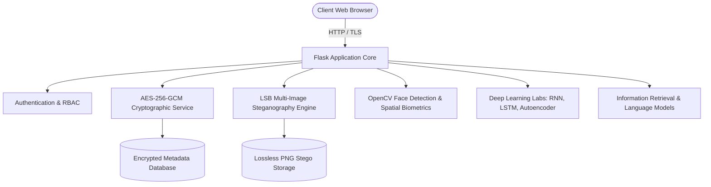

# System Architecture Document

## 1. System Overview
**"Secret Communication Using Multi-Image Steganography and Face Recognition"** is an end-to-end full-stack cybersecurity and AI application.



## 2. Cryptographic Security Architecture
1. **Passphrase-based Key Derivation (PBKDF2-HMAC-SHA256):** Converts user-entered passphrases into 256-bit symmetric keys with 100,000 hash iterations.
2. **AES-GCM Authenticated Encryption:** Employs 96-bit random nonces and generates 128-bit authentication tags, preventing ciphertext tampering.
3. **Payload Sanitization:** Zero confidential plaintext message bytes are written to disk or database tables.

## 3. Multi-Image Steganography Protocol (SEC1)
```
+-------------------------------------------------------------------------+
| SEC1 Header (32 bytes):                                                 |
| Magic (4B) | Ver (1B) | Flags (1B) | ChunkIdx (2B) | TotalChunks (2B)   |
| ChunkLen (4B) | TotalPayloadLen (4B) | MessageUUIDHash (14B)            |
+-------------------------------------------------------------------------+
| Encrypted Ciphertext Chunk Bytes                                        |
+-------------------------------------------------------------------------+
```
Embedded into the least-significant bit (LSB) planes of RGB pixel channels of lossless cover images.
Reconstruction validates matching message UUID hashes, verifies all consecutive chunk indices $0 \dots (N-1)$, and flags duplicate, corrupted, or missing images.
